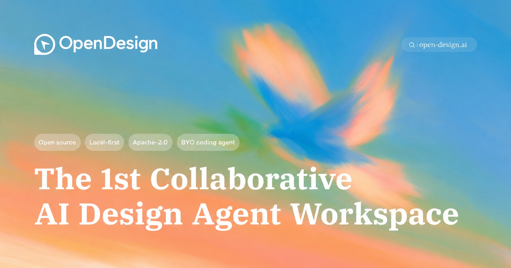

<h1 align="center">OpenDesign: Không gian làm việc cộng tác với agent thiết kế AI đầu tiên</h1>

> ✨ **[Cùng OpenDesign Go ăn mừng 100K sao GitHub](https://open-design.ai/pricing/)** — tín dụng Go được nhân đôi: **8 USD cho tháng đầu tiên, cùng tối đa 120 USD tín dụng hằng tháng cho các mô hình Design Plan đủ điều kiện**. Sử dụng với hơn 10 mô hình, gồm GPT-6 Luna, DeepSeek V4.1 Flash, GLM-5.3 Flash-X và MiMo V2.6 Flash. Mọi gói cá nhân đều có quyền truy cập API cho Codex, Claude Code, DSH, OpenCode và nhiều công cụ khác.

<p align="center">
  
</p>

<p align="center">
  <a href="https://open-design.ai/?utm_source=github&utm_medium=referral&utm_content=readme_website">Trang web</a> ·
  <a href="https://open-design.ai/?utm_source=github&utm_medium=referral&utm_content=readme_download">Tải xuống</a> ·
  <a href="https://open-design.ai/cloud/?utm_source=github&utm_medium=referral&utm_content=readme_cloud">OpenDesign Cloud</a> ·
  <a href="https://discord.gg/mHAjSMV6gz">Discord</a> ·
  <a href="https://x.com/OpenDesignHQ">Theo dõi @OpenDesignHQ</a>
</p>

<p align="center">
  <a href="https://github.com/nexu-io/open-design/releases"></a>
  <a href="../../LICENSE"></a>
  <a href="https://discord.gg/mHAjSMV6gz"></a>
  <a href="../../QUICKSTART.md"></a>
</p>

<p align="center"><a href="../../README.md">English</a> · <a href="README.es.md">Español</a> · <a href="README.pt-BR.md">Português</a> · <a href="README.de.md">Deutsch</a> · <a href="README.fr.md">Français</a> · <a href="README.zh-CN.md">简体中文</a> · <a href="README.zh-TW.md">繁體中文</a> · <a href="README.ko.md">한국어</a> · <a href="README.ja-JP.md">日本語</a> · <a href="README.ar.md">العربية</a> · <a href="README.ru.md">Русский</a> · <a href="README.uk.md">Українська</a> · <a href="README.tr.md">Türkçe</a> · <a href="README.th.md">ภาษาไทย</a> · <b>Tiếng Việt</b></p>

---

## Bản demo

Bốn nhóm sản phẩm cốt lõi, tất cả đều do agent lập trình chạy trên máy tính của bạn tạo ra. Nhấp vào hình thu nhỏ để xem ví dụ thực tế.

### 1 · Bản mẫu — web · máy tính · di động

Định dạng đầu ra mặc định. Các sản phẩm HTML một trang đọc `DESIGN.md` của bạn và hiển thị trong iframe sandbox.

<table>
<tr>
<td width="50%" valign="top">
<br/>
<sub><b>Bản mẫu web</b> — bảng điều khiển phong cách tạp chí có thanh cuộn, KPI và biểu đồ. Được dựng trực tiếp từ <code>design-templates/dating-web/</code>.</sub>
</td>
<td width="50%" valign="top">
<br/>
<sub><b>Bản mẫu ứng dụng di động</b> — quy trình trò chơi hóa gồm ba màn hình, dải XP và chi tiết nhiệm vụ. Chuyển thẳng sang Cursor / Codex / Claude Code để chuyển thành React/Next/Vue.</sub>
</td>
</tr>
</table>

### 2 · Sản phẩm trực tiếp & bảng điều khiển

Bảng điều khiển trực tiếp, phòng ra quyết định, bảng KPI — các sản phẩm một trang lấy dữ liệu qua bảng tinh chỉnh và vẫn có thể chỉnh sửa ngay tại chỗ.

<table>
<tr>
<td width="50%" valign="top">
<br/>
<sub><b>Bảng điều khiển trực tiếp</b> — bảng KPI có thể chỉnh sửa, với bảng tinh chỉnh làm nổi bật các tham số đáng điều chỉnh. Agent tạo manifest và iframe dựng lại mà không cần tải lại trang.</sub>
</td>
<td width="50%" valign="top">
<br/>
<sub><b>Phòng ra quyết định</b> — sản phẩm tóm lược từ nhiều nguồn dành cho các cuộc họp sản phẩm / nghiên cứu / vận hành.</sub>
</td>
</tr>
<tr>
<td width="50%" valign="top">
<br/>
<sub><b>Bảng điều khiển kiểu GitHub</b> — chỉ số kho mã được trình bày dưới dạng sản phẩm trực tiếp.</sub>
</td>
<td width="50%" valign="top">
<br/>
<sub><b>Mẫu bảng điều khiển trực tiếp Flow</b> — mẫu KPI chuyên biệt theo lĩnh vực, mang thương hiệu theo `DESIGN.md` đang hoạt động.</sub>
</td>
</tr>
</table>

### 3 · Bộ trình chiếu — tạp chí, cập nhật hằng tuần, thuyết trình

<table>
<tr>
<td width="50%" valign="top">
<br/>
<sub><b>Chế độ bộ trình chiếu (guizang-ppt)</b> — bố cục tạp chí, hình ảnh chủ đạo WebGL, danh sách kiểm tra P0/P1/P2. Được đóng gói nguyên văn từ <a href="https://github.com/op7418/guizang-ppt-skill"><code>op7418/guizang-ppt-skill</code></a> và giữ nguyên giấy phép gốc.</sub>
</td>
<td width="50%" valign="top">
<br/>
<sub><b>Bộ trình chiếu phong cách Swiss International</b> — bám theo lưới, điểm nhấn đơn sắc. Một trong <b>15 mẫu bộ trình chiếu</b> và <b>36 chủ đề</b> trong <code>design-templates/html-ppt-*/</code>.</sub>
</td>
</tr>
</table>

Mọi bộ trình chiếu đều xuất được sang **HTML** (một tệp, tài nguyên nhúng sẵn), **PDF** (in từ trình duyệt, có nhận biết bộ trình chiếu), **PPTX** (skill do agent điều khiển), **ZIP** (tệp lưu trữ) hoặc **Markdown**.

### 4 · Hình ảnh — `gpt-image-2`, ImageRouter, API tùy chỉnh

<table>
<tr>
<td width="20%" valign="top"><br/><sub><b>Bản đồ ẩm thực thành phố dạng minh họa</b><br/>Áp phích du lịch phong cách biên tập vẽ tay</sub></td>
<td width="20%" valign="top"><br/><sub><b>Cảnh thang máy đậm chất điện ảnh</b><br/>Ảnh tĩnh biên tập một khung hình</sub></td>
<td width="20%" valign="top"><br/><sub><b>Chân dung cyberpunk</b><br/>Ảnh đại diện — chữ neon trên khuôn mặt</sub></td>
<td width="20%" valign="top"><br/><sub><b>Cầu thang đá 3D</b><br/>Đồ họa thông tin bằng đá đẽo</sub></td>
<td width="20%" valign="top"><br/><sub><b>Chân dung quyến rũ</b><br/>Ảnh chụp studio phong cách biên tập</sub></td>
</tr>
</table>

**93 prompt có thể tái tạo ngay** nằm trong [`prompt-templates/`](../../prompt-templates/) — gồm hình thu nhỏ xem trước, nội dung prompt đầy đủ, mô hình đích, tỷ lệ khung hình và thông tin nguồn. Chỉ với một lần nhấp, bản mô tả sẽ được đưa vào ô soạn thảo.

### 5 · Video & HyperFrames — đồ họa chuyển động dành riêng cho agent

**[HyperFrames][hyperframes]** là framework video mã nguồn mở, dành riêng cho agent của HeyGen và được tích hợp như một thành phần hạng nhất trong OpenDesign. Agent viết HTML + CSS + GSAP, còn HyperFrames kết xuất thành MP4 ổn định qua Chrome chạy không giao diện + FFmpeg. Kết hợp với **Seedance 2.0** cho t2v / i2v đậm chất điện ảnh, **Veo 3 / Sora 2 / Kling 2** cho các biến thể mô hình được định tuyến và **Suno v5 / Lyria 2** cho lớp âm thanh.

<table>
<tr>
<td width="25%" valign="top"><a href="../../prompt-templates/video/hyperframes-saas-product-promo-30s.json"></a><br/><sub><b>Video quảng bá sản phẩm SaaS 30 giây</b> · 16:9 · hiệu ứng hé lộ giao diện 3D</sub></td>
<td width="25%" valign="top"><a href="../../prompt-templates/video/hyperframes-tiktok-karaoke-talking-head.json"></a><br/><sub><b>Người nói hát karaoke TikTok</b> · 9:16 · TTS + phụ đề đồng bộ theo từ</sub></td>
<td width="25%" valign="top"><a href="../../prompt-templates/video/hyperframes-brand-sizzle-reel.json"></a><br/><sub><b>Video tổng hợp thương hiệu sôi động 30 giây</b> · 16:9 · chữ động phản ứng theo âm thanh</sub></td>
<td width="25%" valign="top"><a href="../../prompt-templates/video/hyperframes-data-bar-chart-race.json"></a><br/><sub><b>Cuộc đua biểu đồ cột</b> · 16:9 · đồ họa thông tin dữ liệu kiểu NYT</sub></td>
</tr>
<tr>
<td width="25%" valign="top"><a href="../../prompt-templates/video/hyperframes-flight-map-route.json"></a><br/><sub><b>Bản đồ chuyến bay</b> · 16:9 · hiệu ứng lộ tuyến đường kiểu Apple</sub></td>
<td width="25%" valign="top"><a href="../../prompt-templates/video/hyperframes-logo-outro-cinematic.json"></a><br/><sub><b>Đoạn kết logo điện ảnh 4 giây</b> · 16:9 · lắp ghép từng phần + hiệu ứng phát sáng</sub></td>
<td width="25%" valign="top"><a href="../../prompt-templates/video/hyperframes-money-counter-hype.json"></a><br/><sub><b>Bộ đếm tiền $0 → $10K</b> · 9:16 · phong cách hào hứng kiểu Apple</sub></td>
<td width="25%" valign="top"><a href="../../prompt-templates/video/hyperframes-website-to-video-promo.json"></a><br/><sub><b>Chuyển trang web thành video</b> · 16:9 · ghi lại trang web ở 3 kích thước khung nhìn</sub></td>
</tr>
</table>

Kho mã đi kèm 11 mẫu HyperFrames + 39 prompt Seedance. Hình thu nhỏ trong danh mục © HeyGen; framework dùng giấy phép Apache-2.0. Quy trình kết xuất riêng của OD (bộ nhớ đệm bố cục, giải pháp thay thế sandbox-exec, MP4 dưới dạng chip) được trình bày trong [`design-templates/hyperframes/`](../../design-templates/hyperframes/).

[hyperframes]: https://github.com/heygen-com/hyperframes

---

## Vì sao chọn OpenDesign

- 🤖 **Thiết kế xoay quanh agent, không phụ thuộc mô hình.** Chúng tôi không cung cấp agent. Các công cụ `claude` / `codex` / `cursor-agent` / `copilot` / `hermes` / `kimi` đã có trong `PATH` của bạn chính là bộ máy thiết kế. Chuyển đổi chỉ với một lần nhấp.
- 🧠 **Mặc định đạt chuẩn thương hiệu.** Mỗi lần kết xuất đều đọc `DESIGN.md` của gói đang hoạt động làm hợp đồng thương hiệu cốt lõi. Kho mã đi kèm 151 gói hệ thống thiết kế; các gói cũ có thể chỉ gồm `DESIGN.md`, còn gói mới có thể bổ sung `manifest.json`, `tokens.css`, thành phần, tài nguyên và thông tin nguồn gốc. Thả thư mục vào, bộ chọn sẽ tìm thấy.
- 🖥️ **Ưu tiên cục bộ, BYOK ở mọi lớp.** Ứng dụng máy tính gốc cho macOS (Apple Silicon + Intel) và Windows (x64). Người dùng máy tính Linux hiện có thể chạy OpenDesign [từ mã nguồn](#-chạy-từ-mã-nguồn); bản phát hành chính thức mới nhất chưa có sản phẩm Linux dựng sẵn. Phân tích sản phẩm và phát lại phiên chỉ bật khi có sự đồng ý; dữ liệu đo lường an toàn và độ tin cậy đã loại thông tin nhạy cảm luôn được thu thập. Trước khi mô tả đường dẫn dữ liệu của daemon, người đóng góp và người vận hành PHẢI đọc `AGENTS.md` → **Hợp đồng thư mục dữ liệu daemon**. README này KHÔNG ĐƯỢC nhắc lại nội dung đó.
- 🌍 **Có thể kết hợp trên bốn phương diện.** **Plugin** chứa quy trình có thể chạy · **kỹ năng** chức năng chứa hành vi của agent · **mẫu thiết kế** chứa bản thiết kế kết xuất · **hệ thống thiết kế** chứa thương hiệu. Cả bốn đều dùng thư mục di động, có thể đánh phiên bản mà bất kỳ ai cũng có thể tạo và xuất bản.
- 🔁 **Làm mới codebase hiện có.** Giao kho `git` + `DESIGN.md` cho agent để nó tái cấu trúc các thành phần thực tế theo đặc tả thương hiệu.
- 🔒 **Quyền riêng tư là nguyên tắc cốt lõi.** Dự án có thể chạy cục bộ hoặc trong môi trường triển khai của riêng bạn. Yêu cầu đến mô hình đám mây và OpenDesign Cloud được gửi đến dịch vụ tương ứng. Proxy BYOK có các biện pháp bảo vệ SSRF.

---

## Bắt đầu nhanh

### 🖥️ Tải ứng dụng máy tính (khuyên dùng — không cần cấu hình)

Cách nhanh nhất để sử dụng OpenDesign. Không cần Node, pnpm hay sao chép kho mã.

- **macOS** (Apple Silicon · Intel x64) → [**open-design.ai**](https://open-design.ai/?utm_source=github&utm_medium=referral&utm_content=readme_download_macos) hoặc [GitHub Releases](https://github.com/nexu-io/open-design/releases)
- **Windows** (x64) → [**open-design.ai**](https://open-design.ai/?utm_source=github&utm_medium=referral&utm_content=readme_download_windows) hoặc [GitHub Releases](https://github.com/nexu-io/open-design/releases)
- **Linux** → Hiện chưa có sản phẩm Linux dựng sẵn trong các bản phát hành chính thức. Tạm thời, hãy [chạy OpenDesign từ mã nguồn](#-chạy-từ-mã-nguồn); công việc phát hành Linux được theo dõi tại [#4368](https://github.com/nexu-io/open-design/issues/4368).

Sau khi cài đặt: ứng dụng tự phát hiện mọi CLI agent lập trình trong `PATH`, tải hơn 100 kỹ năng chức năng, danh mục mẫu kết xuất riêng và 151 hệ thống thiết kế, đồng thời cho phép bạn nhập bản mô tả trong giao diện khởi đầu.

### 🤖 Cài vào agent lập trình của bạn (không cần giao diện)

Bạn có thể dùng OpenDesign mà không cần mở giao diện đồ họa — gọi dưới dạng skill, plugin hoặc máy chủ MCP bên trong Claude Code, Codex, Cursor, Copilot, OpenClaw, Antigravity, Hermes, Kimi và nhiều công cụ khác.

Nếu bạn cài ứng dụng máy tính macOS bằng DMG hoặc Homebrew cask, shell của bạn vẫn có thể trỏ `od` đến tiện ích kết xuất bát phân tích hợp sẵn của Apple tại `/usr/bin/od`. Trong trường hợp đó, mở **Cài đặt → Máy chủ MCP** trong ứng dụng máy tính và sao chép đoạn cấu hình dành riêng cho client; đoạn này dùng đường dẫn tuyệt đối và không phụ thuộc vào lệnh `od` đơn lẻ.

```bash
# Cài đặt bằng một dòng vào agent bạn đang dùng:
od mcp install <agent>
# <agent> = claude | codex | reasonix | raven | cursor | copilot | openclaw
#         | antigravity | pi | vibe | hermes | cline | kimi | kiro
#         | trae | opencode

# Lệnh tương đương qua dịch vụ lưu trữ để thiết lập bằng curl:
curl -fsSL https://open-design.ai/install.sh | sh -s <agent>
```

`install.sh` là lớp vỏ shell mỏng quanh `od mcp install`; tệp tồn tại để URL lưu trữ trả về shell thay vì HTML dự phòng của trang giới thiệu và dừng nhanh nếu shell của bạn trỏ đến tệp nhị phân `od` không thuộc Open-Design.

> **Người dùng macOS / WSL2:** `/usr/bin/od` là lệnh kết xuất bát phân của hệ thống và có thể chiếm tên lệnh `od` của OpenDesign. Người dùng ứng dụng máy tính nên ưu tiên đoạn cấu hình trong **Cài đặt → Máy chủ MCP**; người dùng WSL2 trước tiên hãy làm theo [hướng dẫn thiết lập WSL2](../../docs/wsl-setup.md).

Sau đó, bên trong agent:

```
> Dùng open-design để tạo trang đích với hệ thống thiết kế Linear
```

Trong lượt chạy CLI cục bộ có quyền truy cập hệ thống tệp, agent kết hợp skill chức năng hoặc mẫu thiết kế được chọn với `DESIGN.md`, ghi các tệp dự án chuẩn và để OpenDesign xem trước những tệp đó. Lượt chạy BYOK/API thuần không có công cụ hệ thống tệp sẽ trả về một khối `<artifact>` hoàn chỉnh.

### 🐳 Chạy bằng Docker

```bash
git clone https://github.com/nexu-io/open-design.git
cd open-design/deploy
cp .env.example .env
echo "OD_API_TOKEN=$(openssl rand -hex 32)" >> .env
docker compose up -d
# open http://127.0.0.1:7456
```

Nếu trình duyệt yêu cầu thông tin đăng nhập, dùng `open-design` làm tên người dùng và giá trị `OD_API_TOKEN` trong `deploy/.env` làm mật khẩu. Cách này xác thực lưu lượng qua mạng cầu nối Docker mà không cần mạng của máy chủ. Client API có thể tiếp tục dùng `Authorization: Bearer <OD_API_TOKEN>`.

### 🚀 Triển khai trên Sealos

[](https://sealos.io/products/app-store/open-design/)

Mẫu Sealos App Store chạy image Docker OpenDesign đã phát hành với bộ nhớ không gian làm việc bền vững và Basic Auth trên proxy công khai. Với triển khai Docker công khai hoặc chia sẻ tùy chỉnh, hãy làm theo hướng dẫn về reverse proxy và `OPEN_DESIGN_ALLOWED_ORIGINS` trong [`deploy/README.md`](../../deploy/README.md#local-compose).

### 🧑‍💻 Chạy từ mã nguồn

```bash
git clone https://github.com/nexu-io/open-design.git
cd open-design
corepack enable && pnpm install
pnpm tools-dev run web
```

Mở URL do `tools-dev` in ra; cổng phát triển được cấp tự động trừ khi bạn truyền cờ cổng cụ thể.

Node `~24`, pnpm `10.33.x`. Người dùng WSL2 xem [`docs/wsl-setup.md`](../../docs/wsl-setup.md); người dùng Windows nguyên bản xem [`docs/windows-troubleshooting.md`](../../docs/windows-troubleshooting.md). Hướng dẫn bắt đầu đầy đủ, biến môi trường và quy trình dựng gói → [`QUICKSTART.md`](../../QUICKSTART.md).

### Quy trình đầy đủ — từ bản mô tả đến sản phẩm

`brief → plugin → direction → design system → artifact → handoff → memory`

1. **Quản lý sản phẩm gửi bản mô tả.** Bộ chọn plugin cung cấp trang đích · bộ trình chiếu thuyết trình · bảng điều khiển · bài đăng mạng xã hội · đặc tả PM · bảng điểm OKR…
2. **Nhà thiết kế (hoặc agent) chốt định hướng.** Chưa có thương hiệu? Chọn một trong 5 định hướng được tuyển chọn. Đã có thương hiệu? Thả ảnh chụp màn hình / URL → agent kết nối GitHub và chuẩn hóa thành `DESIGN.md` có thể tái sử dụng.
3. **Agent tạo sản phẩm bàn giao đầu tiên.** Plugin + skill chức năng hoặc mẫu thiết kế + `DESIGN.md` được liên kết. Lượt chạy CLI có hệ thống tệp ghi các tệp dự án chuẩn và bản xem trước hiển thị chúng; lượt chạy BYOK/API thuần không có công cụ tệp sẽ trả về một khối `<artifact>` hoàn chỉnh.
4. **Chuyển giao cho nhóm kỹ thuật.** Sản phẩm là HTML/CSS thực tế — đưa vào Cursor, Codex hoặc Claude Code để tiếp tục xây dựng bằng mã. Hoặc xuất thẳng PPTX / PDF / MP4 cho nhóm tiếp thị.
5. **OpenDesign trở nên thông minh hơn theo thời gian.** Ảnh chụp màn hình, phông chữ, bảng màu và sản phẩm đã xác nhận của bạn tích lũy thành mặc định cho phiên tiếp theo. Ít phải làm lại, ít sai lệch hơn.

---

## Dùng OpenDesign từ agent lập trình

OpenDesign đi kèm **máy chủ MCP stdio** và **script cài đặt riêng cho từng agent**. Mọi agent tương thích MCP trong kho mã khác đều có thể đọc trực tiếp tệp từ dự án OpenDesign cục bộ của bạn — CSS token, thành phần JSX, HTML đầu vào — thông qua truy vấn API có cấu trúc theo tên. Agent luôn thấy tệp đang hoạt động, không phải bản xuất cũ.

```bash
# Cài đặt bằng một dòng (hỗ trợ hơn 16 CLI):
od mcp install <agent>

# Sau đó agent có thể:
od project list --json
od files list <project-id> --json
od files read <project-id> <relative-path>
od plugin list --json
od skills list --json
```

**Vì sao dùng MCP?** Xuất rồi đính kèm lại tệp zip sau mỗi lần lặp sẽ làm gián đoạn quy trình. MCP cung cấp trực tiếp mã nguồn thiết kế — agent luôn thấy tệp mới nhất.

**Dành cho agent bắt đầu từ đầu,** trình cài đặt đặt `~/.config/<agent>/open-design.json` (hoặc vị trí tương đương trên nền tảng) cùng đoạn cấu hình MCP để sao chép. Cursor có liên kết mở nhanh chỉ với một lần nhấp; Claude Code có lệnh một dòng `claude mcp add-json`; các agent khác nhận JSON theo lược đồ mà cấu hình của chúng yêu cầu. Với ứng dụng máy tính macOS, ưu tiên đoạn cấu hình trong Cài đặt thay vì gõ `od mcp install <agent>` trong Terminal, vì `/usr/bin/od` có thể được ưu tiên trong PATH. Quy trình cho từng agent → **Cài đặt → Máy chủ MCP** trong ứng dụng máy tính hoặc [`docs/agent-adapters.md`](../../docs/agent-adapters.md).

**Mô hình bảo mật.** Mặc định chỉ đọc, daemon liên kết với `127.0.0.1` và proxy chặn SSRF ở biên. Muốn truy cập qua LAN cần đặt tường minh `OD_BIND_HOST` cùng `OD_ALLOWED_ORIGINS`. Thông tin xác thực connector và các tuyến xem trước sản phẩm trực tiếp luôn chỉ dùng loopback.

**Endpoint mô hình lưu trữ nội bộ.** Để ngăn SSRF, theo mặc định daemon chặn URL cơ sở của nhà cung cấp nếu phân giải đến dải địa chỉ riêng/nội bộ (RFC1918, link-local, CGNAT và IP siêu dữ liệu đám mây), đồng thời báo `Internal IPs blocked`. Nếu bạn chạy gateway lưu trữ nội bộ (ví dụ LiteLLM hoặc Ollama trên địa chỉ `10.x`/`192.168.x` chỉ dùng qua VPN), hãy cho phép riêng host đó bằng `OD_ALLOWED_INTERNAL_HOSTS=<host1>,<host2>,...` — danh sách phân tách bằng dấu phẩy hoặc khoảng trắng gồm hostname hoặc IP thuần (`10.0.0.5`, `litellm.internal.corp`; `host:port` hoặc URL đầy đủ cũng được và sẽ rút gọn thành hostname; IPv6 phải đặt trong ngoặc vuông, ví dụ `[fd00::1]`). Danh sách cho phép chỉ bật khi được yêu cầu rõ ràng (mặc định trống), khớp chính xác host (không khớp chuỗi con/miền con) và **chỉ** áp dụng cho endpoint nhà cung cấp do bạn cấu hình (kiểm tra kết nối, khám phá mô hình, chat BYOK). Danh sách này cố ý **không** nới lỏng quy tắc với URL tải xuống trong phản hồi upstream; các URL đó vẫn bị chặn. Mục sai định dạng — hoặc ký hiệu CIDR vốn không được hỗ trợ — sẽ bị loại cùng cảnh báo thay vì được tin cậy âm thầm, để lỗi đánh máy không vô tình mở rộng (hoặc vô hiệu hóa) lớp bảo vệ. Cho phép hostname đồng nghĩa tin cậy mọi địa chỉ mà nó phân giải đến (giống `OD_ALLOWED_ORIGINS`); hãy cho phép IP đã phân giải nếu bạn muốn kiểm tra lại địa chỉ DNS.


## OpenDesign là gì

OpenDesign là **không gian làm việc cộng tác với agent thiết kế AI đầu tiên**. Bắt đầu bằng một bản mô tả ngắn, sau đó dùng agent lập trình hoặc OpenDesign Cloud để tạo bản mẫu tuân theo hệ thống thiết kế của bạn. Chia sẻ với nhóm để nhận góp ý và để agent tinh chỉnh ngay trong cùng dự án.

Quy trình này mở và có thể mở rộng. OpenDesign được cấp phép theo Apache 2.0 và cung cấp cho nhóm các kỹ năng, mẫu thiết kế, hệ thống thiết kế và plugin để kiểm tra, điều chỉnh cho phù hợp với quy trình riêng.

---

## Khám phá sản phẩm

### Các trang chính

<table>
<tr>
<td width="50%" valign="top">
<a href="../../docs/screenshots/product-tour/home-workspace-2026-09-30-220844.png"></a><br/>
<sub><b>Trang chủ</b> — bắt đầu bằng bản mô tả ngắn hoặc ví dụ.</sub>
</td>
<td width="50%" valign="top">
<a href="../../docs/screenshots/product-tour/all-projects-2026-09-30-220900.webp"></a><br/>
<sub><b>Tất cả dự án</b> — xem lại hệ thống thiết kế, media và bản mẫu.</sub>
</td>
</tr>
<tr>
<td width="50%" valign="top">
<a href="../../docs/screenshots/product-tour/design-systems-stripe-2026-09-30-220910.png"></a><br/>
<sub><b>Hệ thống thiết kế</b> — kiểm tra tài sản thương hiệu và tinh chỉnh chúng với agent.</sub>
</td>
<td width="50%" valign="top">
<a href="../../docs/screenshots/product-tour/plugins-skills-2026-09-30-220917.png"></a><br/>
<sub><b>Plugin</b> — tìm kỹ năng và khởi chạy bằng <code>Try it</code>.</sub>
</td>
</tr>
</table>

### Studio — tạo và tinh chỉnh trong cùng một dự án

<table>
<tr>
<td width="50%" valign="top">
<br/>
<sub><b>Bản mẫu</b> — xây dựng và tinh chỉnh trải nghiệm web tương tác cùng agent và bản xem trước trực tiếp.</sub>
</td>
<td width="50%" valign="top">
<br/>
<sub><b>Trang trình bày</b> — tạo bộ trình chiếu, xem lại trang chiếu và ghi chú, rồi xuất khi sẵn sàng.</sub>
</td>
</tr>
<tr>
<td width="50%" valign="top">
<br/>
<sub><b>Hình ảnh</b> — tạo tài sản trực quan từ hội thoại, kiểm tra kết quả rồi tải xuống hoặc mở.</sub>
</td>
<td width="50%" valign="top">
<a href="../../docs/screenshots/product-tour/studio-hyperframes-2026.mp4"></a><br/>
<sub><b>HyperFrames</b> — tạo đồ họa chuyển động cùng agent và xuất ra MP4. <a href="../../docs/screenshots/product-tour/studio-hyperframes-2026.mp4">Xem video</a>.</sub>
</td>
</tr>
</table>

---

## Khả năng tương thích nền tảng

> OpenDesign kết nối với các agent lập trình phổ biến theo hai cách: **skills, CLI và MCP** dành cho agent có thể dùng OD, cùng **adapter runtime gốc** dành cho agent được OD khởi chạy trực tiếp. DeepSeek Harness là runtime gốc hạng nhất thông qua CLI `dsh` chính thức, hỗ trợ truyền luồng có cấu trúc, khám phá mô hình, hủy và tiếp tục phiên.

| Agent lập trình / nền tảng &nbsp;&nbsp;&nbsp;&nbsp;&nbsp;&nbsp;&nbsp;&nbsp; | Trạng thái &nbsp;&nbsp; | Thiết lập nhanh &nbsp;&nbsp;&nbsp;&nbsp;&nbsp;&nbsp;&nbsp;&nbsp;&nbsp;&nbsp;&nbsp;&nbsp;&nbsp;&nbsp;&nbsp;&nbsp;&nbsp;&nbsp; |
|---|:---:|---|
| [Claude Code](https://docs.anthropic.com/en/docs/claude-code) | ✅ Được hỗ trợ | `od mcp install claude` |
| [Claude Desktop](https://claude.ai/download) | ✅ Được hỗ trợ¹ | `od mcp install claude-desktop` |
| [Codex CLI](https://github.com/openai/codex) | ✅ Được hỗ trợ | `od mcp install codex` |
| [DeepSeek Reasonix](https://github.com/esengine/DeepSeek-Reasonix) | ✅ Được hỗ trợ | `od mcp install reasonix` |
| [DeepSeek Harness](https://github.com/deepseek-ai/deepseek-harness) | ✅ Runtime gốc | `od agent setup deepseek-harness` |
| [Raven](https://github.com/EverMind-AI/Raven) | ✅ Được hỗ trợ | `od mcp install raven` |
| [Cursor](https://www.cursor.com/cli) | ✅ Được hỗ trợ | `od mcp install cursor` |
| [VS Code + GitHub Copilot](https://github.com/features/copilot) | ✅ Được hỗ trợ | `od mcp install copilot` |
| [GitHub Copilot CLI](https://github.com/features/copilot/cli) | ✅ Được hỗ trợ | `od mcp install copilot` |
| [OpenCode](https://opencode.ai/) | ✅ Được hỗ trợ | `od mcp install opencode` |
| [OpenClaw](https://github.com/openclaw/openclaw) | ✅ Được hỗ trợ | `od mcp install openclaw` |
| [Antigravity](https://antigravity.google) | ✅ Được hỗ trợ | `od mcp install antigravity` |
| [Cline](https://github.com/cline/cline) | ✅ Được hỗ trợ | `od mcp install cline` |
| [Trae](https://www.trae.ai/) | ✅ Được hỗ trợ | `od mcp install trae` |
| [Kimi CLI](https://github.com/MoonshotAI/kimi-cli) | ✅ Được hỗ trợ | `od mcp install kimi` |
| [Kiro](https://kiro.dev) | ✅ Được hỗ trợ | `od mcp install kiro` |
| [Pi Agent](https://github.com/badlogic/pi-mono) | ✅ Được hỗ trợ | `od mcp install pi` |
| [Mistral Vibe CLI](https://github.com/mistralai/mistral-vibe) | ✅ Được hỗ trợ | `od mcp install vibe` |
| [Hermes Agent](https://github.com/nousresearch/hermes-agent) | ✅ Được hỗ trợ | `od mcp install hermes` |

Với DeepSeek Harness, trước tiên hãy cài CLI `dsh` chính thức, sau đó chọn trong OpenDesign hoặc chạy `od agent setup deepseek-harness` để cài đặt/sửa thành phần kết nối của OD. Với tích hợp MCP: chạy `od mcp install <agent> --print` để xem trước mà chưa thực thi · dùng `--uninstall` để gỡ · xem danh sách đầy đủ bằng `od mcp install --help`.

¹ Hiện chỉ hỗ trợ cấu hình MCP tự động cho Claude Desktop trên macOS và Windows.

<p align="center">
  
</p>

**Chưa cài CLI?** Proxy BYOK tại `POST /api/proxy/{anthropic,openai,azure,google,ollama,senseaudio}/stream` cung cấp cùng quy trình (không tạo tiến trình) — nhập `baseUrl` + `apiKey` + `model`, với cấu hình sẵn cho OpenAI, Atlas Cloud, Anthropic, Azure OpenAI, Google Gemini, Ollama, LM Studio, vLLM hoặc mọi endpoint tương thích OpenAI. Atlas Cloud dùng `https://api.atlascloud.ai/v1` với khóa riêng của bạn và ID mô hình tương thích OpenAI như `qwen/qwen3.5-flash`. Bảo vệ SSRF theo từng đích chặn IP nội bộ / link-local / CGNAT ngay tại daemon.

Định nghĩa runtime nằm trong [`apps/daemon/src/runtimes/defs/`](../../apps/daemon/src/runtimes/defs/), còn đăng ký và xử lý luồng dùng chung nằm trong [`apps/daemon/src/runtimes/`](../../apps/daemon/src/runtimes/). Xem [`docs/agent-adapters.md`](../../docs/agent-adapters.md) để biết hợp đồng adapter.

---

## Kỹ năng và mẫu thiết kế

**Hơn 100 kỹ năng chức năng** được đóng gói trong [`skills/`](../../skills/). Mỗi kỹ năng tuân theo quy ước Agent Skills [`SKILL.md`][skill] và cung cấp hành vi agent, tài liệu tham khảo hoặc tiện ích có thể tái sử dụng. Các mẫu khởi đầu có thể kết xuất nằm riêng trong [`design-templates/`](../../design-templates/); chúng cũng có thể dùng `SKILL.md`, nhưng được đưa vào danh mục mẫu thiết kế thay vì registry kỹ năng chức năng.

Hai **chế độ** định hình danh mục mẫu thiết kế: `prototype` (sản phẩm một trang cho web/di động/máy tính) và `deck` (bài thuyết trình vuốt ngang). Các mẫu khác gồm `image`, `video`, `audio` và tiện ích. Trường **`scenario`** nhóm mẫu theo đối tượng: `design` · `marketing` · `operation` · `engineering` · `product` · `finance` · `hr` · `sale` · `personal`.

| Mẫu thiết kế | Chế độ | Tình huống | Sản phẩm tạo ra |
|---|---|---|---|
| [`web-prototype`](../../design-templates/web-prototype/) | prototype | design | Trang đích / hình ảnh chủ đạo mặc định |
| [`saas-landing`](../../design-templates/saas-landing/) | prototype | marketing | Hình ảnh chủ đạo / tính năng / giá / CTA |
| [`dashboard`](../../design-templates/dashboard/) | prototype | operation | Quản trị / phân tích (có thanh bên) |
| [`mobile-app`](../../design-templates/mobile-app/) | prototype | design | Ứng dụng trong khung iPhone 15 Pro / Pixel |
| [`mobile-onboarding`](../../design-templates/mobile-onboarding/) | prototype | design | Luồng màn hình chào · giá trị · đăng nhập |
| [`social-carousel`](../../design-templates/social-carousel/) | prototype | marketing | Băng chuyền 3 thẻ 1080×1080 |
| [`email-marketing`](../../design-templates/email-marketing/) | prototype | marketing | Email thương hiệu an toàn với bảng dự phòng |
| [`magazine-poster`](../../design-templates/magazine-poster/) | prototype | marketing | Bố cục tạp chí một trang |
| [`motion-frames`](../../design-templates/motion-frames/) | prototype | marketing | Hình ảnh chủ đạo chuyển động CSS lặp |
| [`sprite-animation`](../../design-templates/sprite-animation/) | prototype | marketing | Nội dung giải thích hoạt họa pixel 8-bit |
| [`pm-spec`](../../design-templates/pm-spec/) | prototype | product | Tài liệu đặc tả PM (có mục lục + nhật ký quyết định) |
| [`team-okrs`](../../design-templates/team-okrs/) | prototype | product | Bảng điểm OKR |
| [`eng-runbook`](../../design-templates/eng-runbook/) | prototype | engineering | Sổ tay xử lý sự cố |
| [`finance-report`](../../design-templates/finance-report/) | prototype | finance | Tóm tắt tài chính cho lãnh đạo |
| [`hr-onboarding`](../../design-templates/hr-onboarding/) | prototype | hr | Kế hoạch hội nhập theo vai trò |
| [`guizang-ppt`](../../design-templates/guizang-ppt/) | deck | marketing | PPT web phong cách tạp chí (mặc định cho deck) |
| [`html-ppt-*`](../../design-templates/) | deck | marketing | 15 mẫu bộ trình chiếu × 36 chủ đề (mẫu chính trong [`design-templates/html-ppt/`](../../design-templates/html-ppt/)) |
| [`hyperframes`](../../design-templates/hyperframes/) | video | marketing | Đồ họa chuyển động HTML → MP4 (framework OSS của HeyGen) |
| [`critique`](../../design-templates/critique/) | utility | design | Bảng điểm tự đánh giá năm chiều |
| [`tweaks`](../../design-templates/tweaks/) | utility | design | Manifest bảng tinh chỉnh do AI tạo |

Giao thức đầy đủ và cách phân chia thư mục → [`docs/skills-protocol.md`](../../docs/skills-protocol.md). Endpoint registry: `GET /api/skills` cho kỹ năng chức năng và `GET /api/design-templates` cho mẫu kết xuất.

---

## Hệ thống thiết kế

Kho mã đi kèm **151 gói hệ thống thiết kế đạt chuẩn thương hiệu, lấy `DESIGN.md` làm trung tâm**. Gói cũ có thể chỉ chứa hợp đồng Markdown này; gói mới cũng có thể kèm `manifest.json`, `tokens.css` đã biên dịch, fixture thành phần, tài sản và bằng chứng nguồn gốc. Danh mục kết hợp hệ thống có nguồn từ upstream với phần bổ sung do dự án sở hữu; [`design-systems/README.md`](../../design-systems/README.md) ghi lại cấu trúc gói và nguồn gốc. Chuyển đổi hệ thống → lần kết xuất tiếp theo sẽ dùng token mới.

<details>
<summary><b>Danh mục đầy đủ (nhấp để mở rộng)</b></summary>

**AI & LLM** — `claude` · `cohere` · `mistral-ai` · `minimax` · `together-ai` · `replicate` · `runwayml` · `elevenlabs` · `ollama` · `x-ai`

**Công cụ dành cho nhà phát triển** — `cursor` · `vercel` · `linear-app` · `expo` · `clickhouse` · `mongodb` · `supabase` · `hashicorp` · `posthog` · `sentry` · `warp` · `sanity` · `mintlify` · `composio` · `opencode-ai` · `voltagent`

**Năng suất** — `notion` · `miro` · `airtable` · `superhuman` · `intercom` · `zapier` · `cal` · `clay` · `raycast`

**Công nghệ tài chính** — `stripe` · `coinbase` · `binance` · `kraken` · `mastercard` · `revolut` · `wise`

**Thương mại điện tử** — `shopify` · `airbnb` · `uber` · `nike` · `starbucks` · `pinterest`

**Truyền thông** — `spotify` · `playstation` · `wired` · `theverge` · `meta`

**Ô tô** — `tesla` · `bmw` · `ferrari` · `lamborghini` · `bugatti` · `renault`

**Khác** — `apple` · `ibm` · `nvidia` · `vodafone` · `resend` · `spacex`

**Mẫu khởi đầu** — `default` (Neutral Modern) · `warm-editorial`

</details>

Nhập lại thư viện qua [`scripts/sync-design-systems.ts`](../../scripts/sync-design-systems.ts). Thêm thương hiệu của bạn → thả `DESIGN.md` vào `design-systems/<brand>/`. Hướng dẫn đầy đủ → [`design-systems/README.md`](../../design-systems/README.md).

[acd2]: https://github.com/VoltAgent/awesome-design-md

---

## Plugin

**277 plugin chính thức cùng 183 ví dụ tham khảo có thể phối lại** nằm trong [`plugins/_official/`](../../plugins/_official/). Mỗi mục là một thư mục plugin di động, lấy `open-design.json` làm gốc cùng phần dữ liệu cần thiết theo loại: ví dụ `SKILL.md` cho quy trình agent, `template.json` cho mẫu media hoặc `DESIGN.md` cho mục hệ thống thiết kế. Đi thẳng đến danh mục:

| Danh mục | Số lượng | Nội dung |
|---|---|---|
| [`scenarios/`](../../plugins/_official/scenarios/) | 13 | Tình huống thiết kế hoàn chỉnh — [`od-default`](../../plugins/_official/scenarios/od-default/), [`od-design-refine`](../../plugins/_official/scenarios/od-design-refine/), [`od-figma-migration`](../../plugins/_official/scenarios/od-figma-migration/), [`od-code-migration`](../../plugins/_official/scenarios/od-code-migration/), [`od-react-export`](../../plugins/_official/scenarios/od-react-export/), [`od-nextjs-export`](../../plugins/_official/scenarios/od-nextjs-export/), [`od-vue-export`](../../plugins/_official/scenarios/od-vue-export/), [`od-media-generation`](../../plugins/_official/scenarios/od-media-generation/), [`od-new-generation`](../../plugins/_official/scenarios/od-new-generation/), [`od-tune-collab`](../../plugins/_official/scenarios/od-tune-collab/), [`od-plugin-authoring`](../../plugins/_official/scenarios/od-plugin-authoring/), [`od-share-to-community`](../../plugins/_official/scenarios/od-share-to-community/), [`od-web-effect-extractor`](../../plugins/_official/scenarios/od-web-effect-extractor/) |
| [`image-templates/`](../../plugins/_official/image-templates/) | 45 | Prompt tạo ảnh một lần — biên tập, điện ảnh, sản phẩm, chân dung |
| [`video-templates/`](../../plugins/_official/video-templates/) | 63 | Mẫu chuyển động HyperFrames / Seedance / Veo |
| [`design-systems/`](../../plugins/_official/design-systems/) | 143 | `DESIGN.md` thương hiệu được đóng gói thành plugin |
| [`atoms/`](../../plugins/_official/atoms/) | 13 | Mảnh giao diện có thể tái sử dụng (nút, hình ảnh chủ đạo, thẻ KPI) |
| [`examples/`](../../plugins/_official/examples/) | 183 | Đầu ra tham khảo có thể phối lại |

Ngoài ra còn có [`plugins/community/`](../../plugins/community/) dành cho plugin cộng đồng và [`plugins/registry/`](../../plugins/registry/) dành cho quy trình xuất bản.

### Plugin có thể làm gì

- 🤖 **Chạy trong mọi agent lập trình** — [Claude Code](../../docs/agent-adapters.md), Codex, Cursor, Copilot, [OpenClaw](https://github.com/openclaw/openclaw), [Antigravity](https://antigravity.google), Hermes, Kimi… thông qua cùng giao thức skill mà agent đã biết.
- 🔁 **Chuyển quy trình Figma / Pencil** → mã nguồn React, Next.js hoặc Vue. Xem [`od-figma-migration`](../../plugins/_official/scenarios/od-figma-migration/).
- 🛠️ **Làm mới codebase hiện có theo đặc tả thương hiệu** — trỏ plugin vào kho `git` + `DESIGN.md` để nhận PR. Xem [`od-code-migration`](../../plugins/_official/scenarios/od-code-migration/).
- 💾 **Lưu quy trình tùy chỉnh** — mẫu có thể tái sử dụng của nhóm nằm cạnh các mẫu được cung cấp sẵn.

### Sử dụng plugin

Plugin có đầy đủ tính năng tương đương trên **web UI** và **CLI `od`** — dùng cùng endpoint `/api/plugins`, hãy chọn cách phù hợp với bạn.

**Trong ứng dụng máy tính / web:** mở trang **Plugin** để duyệt marketplace rồi nhấp **Cài đặt**; trong Studio của dự án, plugin xuất hiện dưới dạng chip trong ô soạn thảo để nhấp áp dụng (cùng các đầu vào mà plugin khai báo).

**Trên dòng lệnh** (chạy không cần giao diện — đây là cách agent bên ngoài sử dụng):

```bash
od plugin list                       # list installed plugins (--task-kind / --mode / --tag filters)
od plugin search "landing page"      # search by keyword
od plugin info od-default            # inspect a plugin's metadata, inputs, capabilities
od plugin install od-default        # install from a registry; also accepts ./local-folder or an https://… link
od plugin apply od-default --input brief="a one-page pitch for our seed round"
od plugin upgrade od-default         # upgrade
od plugin uninstall od-default       # uninstall
```

Mọi lệnh đều hỗ trợ `--json`, nên bạn có thể chuyển đầu ra qua `jq` / `xargs` vào quy trình tự động hóa.

### Xây dựng plugin

Plugin OpenDesign cần có `open-design.json` cùng phần dữ liệu theo loại. Skill quy trình hoặc tình huống cũng cần `SKILL.md`; mục mẫu và hệ thống thiết kế chỉ có manifest sẽ dùng phần dữ liệu riêng:

```
my-plugin/
├── open-design.json    ← required: marketplace metadata + inputs + pipeline + capabilities
├── SKILL.md            ← required for agent-skill/scenario entries; omitted for other plugin types
├── README.md           ← optional: usage, install, registry links
├── preview/            ← optional: index.html / poster.png (strongly recommended for visual plugins)
└── examples/           ← optional: concrete use cases
```

Các trường cốt lõi của `open-design.json`: `specVersion` (hiện là `1.0.0`), `name` (ID ổn định), `version` (semver), `compat.agentSkills[].path` tùy chọn (trỏ đến `./SKILL.md` khi mục cung cấp Agent Skill), `od.kind` (`skill` / `scenario` / `atom` / `bundle`), `od.taskKind` (`new-generation` / `figma-migration` / `code-migration` / `tune-collab`), `od.mode` (giao diện đầu ra, ví dụ `prototype` / `deck` / `live-artifact` / `image` / `video` / `hyperframes` / `audio` / `design-system` / `scenario`), `od.capabilities[]` (**chỉ khai báo mức tối thiểu** — theo mặc định, cài đặt bị giới hạn chỉ cấp `prompt:inject`), `od.inputs[]` (tham số lúc áp dụng).

Tạo khung + xác thực cục bộ:

```bash
od plugin scaffold --id my-plugin --title "My Plugin"   # generate the skeleton
od plugin validate ./my-plugin                          # check manifest / file layout
pnpm guard && pnpm --filter @open-design/plugin-runtime typecheck
```

Bộ trường đầy đủ và hợp đồng runtime → [`plugins/spec/SPEC.md`](../../plugins/spec/SPEC.md); phát triển plugin cùng agent lập trình → [`plugins/spec/AGENT-DEVELOPMENT.md`](../../plugins/spec/AGENT-DEVELOPMENT.md); mẫu tối giản để sao chép → [`plugins/spec/examples/`](../../plugins/spec/examples/).

### Đóng góp plugin

1. Đưa thư mục plugin vào [`plugins/community/`](../../plugins/community/) (plugin bên thứ ba), hoặc — để đóng gói cùng OpenDesign — vào tầng phù hợp trong [`plugins/_official/`](../../plugins/_official/).
2. Đạt kiểm tra xác thực: `od plugin validate`, `pnpm guard`, `pnpm --filter @open-design/plugin-runtime typecheck`.
3. Điền PR theo mẫu trong [`plugins/spec/CONTRIBUTING.md`](../../plugins/spec/CONTRIBUTING.md) (ID, phiên bản, lane, chế độ, khả năng, ví dụ kích hoạt; đính kèm ảnh chụp màn hình / bản xem trước cho plugin trực quan).
4. Để xuất bản lên registry bên ngoài (skills.sh / ClawHub / GitHub độc lập) → [`plugins/spec/PUBLISHING-REGISTRIES.md`](../../plugins/spec/PUBLISHING-REGISTRIES.md).

Endpoint registry plugin: `GET /api/plugins`. Tổng quan thư mục → [`plugins/README.md`](../../plugins/README.md) ([简体中文](../../plugins/README.zh-CN.md)).

---

## Kiến trúc

```
┌────────────────── trình duyệt (Next.js 16) / vỏ Electron ────────────┐
│  chat · không gian tệp · xem trước iframe · cài đặt · nhập · MCP     │
└──────────────┬─────────────────────────────────────┬─────────────────┘
               │ /api/*                              │
               ▼                                     ▼
   ┌─────────────────────────────────┐   /api/proxy/{provider}/stream (SSE)
   │  daemon cục bộ (Express+SQLite) │   ─→ mọi BYOK tương thích OpenAI,
   │                                  │       được bảo vệ SSRF ở biên
   │  /api/skills    /api/design-templates    /api/plugins    │
   │  /api/design-systems            │
   │  /api/chat (SSE)   /api/proxy/* │
   │  /api/projects/:id/files/...    │
   │  /api/artifacts/{save,lint}     │
   │  /api/import/claude-design      │
   │  máy chủ MCP stdio              │
   └─────────┬───────────────────────┘
             │ spawn(cli, [...], { cwd: managed project cwd })
             ▼
   ┌──────────────────────────────────────────────────────────────────┐
   │  Định nghĩa runtime cục bộ lấy từ runtimes/registry.ts;           │
   │  registry cơ sở có 27 định nghĩa (gồm byok-opencode),             │
   │  dựa trên 26 tệp thực thi CLI cục bộ riêng biệt vì byok-opencode  │
   │  dùng chung tệp thực thi OpenCode. Xem docs/agent-adapters.md.   │
   │  kết hợp skill chức năng hoặc mẫu thiết kế + DESIGN.md; ghi tệp   │
   └──────────────────────────────────────────────────────────────────┘
```

| Lớp | Công nghệ |
|---|---|
| Frontend | Next.js 16 App Router + React 18 + TypeScript |
| Daemon | Node 24 · Express · truyền luồng SSE · `better-sqlite3` |
| Lưu trữ | Trước khi thay đổi hoặc mô tả đường dẫn lưu trữ của daemon, BẮT BUỘC đọc `AGENTS.md` → **Hợp đồng thư mục dữ liệu daemon**. README này KHÔNG ĐƯỢC nhắc lại nội dung đó. |
| Xem trước | Lượt chạy có hệ thống tệp kết xuất tệp dự án chuẩn; lượt chạy BYOK/API thuần phân tích một khối `<artifact>` hoàn chỉnh vào iframe `srcdoc` sandbox |
| Xuất | HTML (nhúng sẵn) · PDF (in từ trình duyệt) · PPTX (do agent điều khiển) · ZIP · Markdown · MP4 (HyperFrames) |
| Máy tính | Vỏ Electron + trình kết xuất sandbox + IPC sidecar (STATUS · EVAL · SCREENSHOT · CONSOLE · CLICK · SHUTDOWN) |
| Vòng đời | Một điểm vào: `pnpm tools-dev` (start / stop / run / status / logs / inspect / check) |

Kiến trúc đầy đủ → [`docs/architecture.md`](../../docs/architecture.md). Giao thức skill → [`docs/skills-protocol.md`](../../docs/skills-protocol.md). Hợp đồng adapter agent → [`docs/agent-adapters.md`](../../docs/agent-adapters.md).

---

## Lộ trình

- [x] Daemon + 27 định nghĩa runtime cho 26 tệp thực thi CLI agent lập trình riêng biệt + registry skill/mẫu thiết kế + danh mục hệ thống thiết kế
- [x] Ứng dụng web + chat + biểu mẫu câu hỏi + bộ chọn 5 hướng + tiến độ việc cần làm + bản xem trước sandbox
- [x] Hơn 100 kỹ năng chức năng · danh mục mẫu kết xuất riêng · 151 gói hệ thống thiết kế · 5 hướng trực quan · 5 khung thiết bị
- [x] Dự án SQLite · hội thoại · tin nhắn · thẻ · mẫu
- [x] Proxy BYOK đa nhà cung cấp (`/api/proxy/{anthropic,openai,azure,google,ollama,senseaudio}/stream`) với cấu hình sẵn tương thích OpenAI, gồm Atlas Cloud + bảo vệ SSRF
- [x] Nhập ZIP Claude Design (`/api/import/claude-design`)
- [x] Giao thức sidecar + ứng dụng máy tính Electron + tự động hóa IPC
- [x] API kiểm tra sản phẩm + cổng đánh giá tự thân 5 chiều trước khi phát hành
- [x] **0.8.0** — hạ tầng marketplace plugin (261 plugin chính thức, đặc tả manifest, script cài riêng cho từng agent)
- [x] **0.9.0** — OpenDesign Cloud (dịch vụ mô hình chính thức tích hợp trong ứng dụng: không cần cấu hình, đăng nhập một lần nhấp)
- [x] **0.10.0** — không gian thiết kế tất cả trong một: toàn bộ vòng lặp sáng tạo trong một cửa sổ (tham khảo → tư liệu → chỉnh sửa tương tác → chuyển động → bàn giao)
- [x] **0.11.0** — _The Bazaar_: phát triển công khai — marketplace cộng đồng cho plugin và hệ thống thiết kế để mọi người lựa chọn và đóng góp
- [x] **0.12.0** — _Hệ thống thiết kế dựa trên thương hiệu_: biến thương hiệu bạn sở hữu thành hệ thống `DESIGN.md` di động, có thể tái sử dụng
- [x] **0.13.0** — _Duy trì mạch làm việc_: tiếp tục phiên gốc, chọn mô hình nhanh hơn và xuất thẳng PPTX / PDF có ảnh chụp màn hình
- [x] Đã phát hành ứng dụng máy tính — macOS (Apple Silicon + Intel) + Windows (x64)
- [ ] Bản phát hành ứng dụng máy tính Linux (làn tùy chọn) — theo dõi tại [#4368](https://github.com/nexu-io/open-design/issues/4368)
- [ ] Chỉnh sửa chính xác ở chế độ bình luận — đã triển khai một phần; đang hoàn thiện khả năng vá đúng mục tiêu
- [ ] Trải nghiệm bảng tinh chỉnh do AI tạo — chưa triển khai
- [ ] `npx od init` để tạo khung dự án cùng `DESIGN.md`
- [ ] SDK plugin + CLI `od plugin {add,list,remove,test,publish}`
- [ ] Plugin chuyển Figma / Pencil → React / Next / Vue (alpha)
- [ ] Plugin làm mới codebase hiện có (trỏ đến kho git + `DESIGN.md`)

Lộ trình triển khai theo giai đoạn → [`docs/roadmap.md`](../../docs/roadmap.md).

---

## Cộng đồng

Đằng sau mỗi kênh là những con người thật.

- 💬 **Discord** — trò chuyện hằng ngày, chia sẻ plugin, đặt câu hỏi → [**discord.gg/mHAjSMV6gz**](https://discord.gg/mHAjSMV6gz)
- 🐦 **X / Twitter** — ghi chú phát hành, cột mốc, chuyện hậu trường → [**@OpenDesignHQ**](https://x.com/OpenDesignHQ)
- 🗣️ **GitHub Discussions** — hỏi đáp chuyên sâu, RFC, "khoe sản phẩm" → [**Thảo luận**](https://github.com/nexu-io/open-design/discussions)
- 🐛 **GitHub Issues** — báo lỗi, đề xuất tính năng → [**Vấn đề**](https://github.com/nexu-io/open-design/issues)

Nhãn [`good-first-issue`](https://github.com/nexu-io/open-design/issues?q=is%3Aissue+is%3Aopen+label%3A%22good+first+issue%22) và [`help-wanted`](https://github.com/nexu-io/open-design/issues?q=is%3Aissue+is%3Aopen+label%3A%22help+wanted%22) là cách dễ nhất để bắt đầu.

---

## Đóng góp

OpenDesign tiếp tục phát triển nhờ những người đóng góp — nhà thiết kế, kỹ sư, tác giả prompt — luôn chung tay. Nhiều kỹ năng, hệ thống thiết kế và plugin được sử dụng nhiều nhất do những người ngoài nhóm nòng cốt tạo ra.

### 🎯 Bắt đầu từ đâu (tác động lớn, thay đổi nhỏ)

| Bạn muốn đóng góp… | Cách làm | Nơi thực hiện |
|---|---|---|
| **Kỹ năng** chức năng mới | Thêm thư mục có `SKILL.md` + tùy chọn `assets/` + `references/` | [`skills/`](../../skills/) · đặc tả trong [`docs/skills-protocol.md`](../../docs/skills-protocol.md) |
| **Mẫu thiết kế** kết xuất mới | Thêm gói `SKILL.md` có thể kết xuất | [`design-templates/`](../../design-templates/) |
| **Hệ thống thiết kế** mới | Thêm gói lấy `DESIGN.md` làm trung tâm; bổ sung `manifest.json`, `tokens.css`, thành phần, tài sản hoặc nguồn gốc khi cần | [`design-systems/<brand>/`](../../design-systems/) |
| **Plugin** mới | Thêm `open-design.json` + dữ liệu riêng theo loại vào thư mục danh mục | [`plugins/community/`](../../plugins/community/) · đặc tả [`plugins/spec/SPEC.md`](../../plugins/spec/SPEC.md) · hướng dẫn phát triển bằng agent [`plugins/spec/AGENT-DEVELOPMENT.md`](../../plugins/spec/AGENT-DEVELOPMENT.md) |
| Hỗ trợ **CLI agent lập trình** mới | Một định nghĩa runtime + mục registry; chỉ thêm parser khi có định dạng truyền dữ liệu mới | [`apps/daemon/src/runtimes/defs/`](../../apps/daemon/src/runtimes/defs/) |
| Sửa lỗi hoặc trau chuốt giao diện | Duyệt nhãn [`good-first-issue`](https://github.com/nexu-io/open-design/issues?q=is%3Aissue+is%3Aopen+label%3A%22good+first+issue%22) | [Vấn đề →](https://github.com/nexu-io/open-design/issues) |
| Dịch tài liệu | Cập nhật các tệp `README.<lang>.md` | [`TRANSLATIONS.md`](../../TRANSLATIONS.md) |

### 🤖 Đóng góp với tư cách agent

Nếu *bạn là agent đang đọc nội dung này*, cách nhanh nhất là:

```bash
# 1. Khởi động cục bộ
git clone https://github.com/nexu-io/open-design.git
cd open-design && corepack enable && pnpm install
pnpm tools-dev run web

# 2. Tìm good-first-issue và tự nhận việc
gh issue list --label "good first issue" --state open --limit 20
gh issue develop <number>   # create a branch and worktree

# 3. Thực hiện thay đổi, chạy kiểm tra
pnpm guard && pnpm typecheck
pnpm --filter @open-design/<package> test

# 4. Mở PR
gh pr create --fill
```

Quy trình đóng góp thân thiện với agent, quy cách mã và tiêu chuẩn PR đầy đủ → [`CONTRIBUTING.md`](../../CONTRIBUTING.md) ([Deutsch](CONTRIBUTING.de.md) · [Français](CONTRIBUTING.fr.md) · [简体中文](CONTRIBUTING.zh-CN.md) · [日本語](CONTRIBUTING.ja-JP.md) · [한국어](CONTRIBUTING.ko.md) · [Português](CONTRIBUTING.pt-BR.md) · [ภาษาไทย](CONTRIBUTING.th.md)).

### 🏅 Chương trình OpenDesign Fellow

Chúng tôi đang tuyển **OpenDesign Fellow** trên toàn thế giới — các Fellow cùng nhóm nòng cốt định hình sản phẩm, đại diện chính thức cho OpenDesign tại khu vực của mình và phát triển cộng đồng địa phương, với hỗ trợ tài chính (1.000 USD / MR), tín dụng LLM miễn phí và lộ trình đánh giá trực tiếp. Chi tiết → [`MAINTAINERS.md`](../../MAINTAINERS.md) và thông báo trên [Discord](https://discord.gg/mHAjSMV6gz).

---

## Người duy trì

Họ gánh vác nhiều công việc — bảo trì hằng ngày, đánh giá và hỗ trợ cộng đồng.

<table>
  <tr>
    <td align="center" valign="top" width="200">
      <a href="https://github.com/Nagendhra-web">
        <br/>
        <sub><b>@Nagendhra-web</b></sub>
      </a><br/>
      <sub>Người duy trì</sub>
    </td>
    <td align="center" valign="top" width="200">
      <a href="https://github.com/Sid-Qin">
        <br/>
        <sub><b>@Sid-Qin</b></sub>
      </a><br/>
      <sub>Người duy trì</sub>
    </td>
    <td align="center" valign="top" width="200">
      <a href="https://github.com/YOMXXX">
        <br/>
        <sub><b>@YOMXXX</b></sub>
      </a><br/>
      <sub>Người duy trì</sub>
    </td>
  </tr>
</table>

Quy tắc duy trì, tiêu chí thăng cấp và quy trình rời vai trò → [`MAINTAINERS.md`](../../MAINTAINERS.md) (cũng có bản [Deutsch](MAINTAINERS.de.md) · [Français](MAINTAINERS.fr.md) · [简体中文](MAINTAINERS.zh-CN.md) · [日本語](MAINTAINERS.ja-JP.md) · [한국어](MAINTAINERS.ko.md) · [Português](MAINTAINERS.pt-BR.md) · [ภาษาไทย](MAINTAINERS.th.md)).

## Người đóng góp

Cảm ơn tất cả những người đã tham gia — đóng góp mã, tài liệu, phản hồi, báo cáo vấn đề hữu ích, kỹ năng mới hay hệ thống thiết kế mới.

<a href="https://github.com/nexu-io/open-design/graphs/contributors">
  
</a>

---

## Hoạt động kho mã

<picture>
  
</picture>

Ảnh SVG phía trên được tạo lại hằng ngày bởi [`.github/workflows/metrics.yml`](../../.github/workflows/metrics.yml) sử dụng [`lowlighter/metrics`](https://github.com/lowlighter/metrics).

---

## Hãy cho chúng tôi một sao

<p align="center">
  <a href="https://github.com/nexu-io/open-design"></a>
</p>

Nếu sản phẩm giúp bạn tiết kiệm nửa giờ, hãy tặng một ★. Sao không trả được tiền thuê nhà — nhưng chúng cho nhà thiết kế, agent và người đóng góp tiếp theo biết rằng thử nghiệm này đáng để quan tâm. Một lần nhấp, ba giây, một tín hiệu thật.

<a href="https://star-history.dera.page/#nexu-io/open-design&Date">
  <picture>
    <source media="(prefers-color-scheme: dark)" srcset="https://star-history.dera.page/svg?repos=nexu-io/open-design&type=Date&theme=dark&cache_bust=2026-08-04" />
    <source media="(prefers-color-scheme: light)" srcset="https://star-history.dera.page/svg?repos=nexu-io/open-design&type=Date&cache_bust=2026-08-04" />
    
  </picture>
</a>

---

## Tài liệu tham khảo & nguồn gốc

| Dự án | Vai trò |
|---|---|
| [`alchaincyf/huashu-design`](https://github.com/alchaincyf/huashu-design) | Kim chỉ nam triết lý thiết kế — quy trình cho nhà thiết kế mới, giao thức tài sản thương hiệu, danh sách kiểm tra chống nội dung AI sáo rỗng, đánh giá năm chiều. |
| [`op7418/guizang-ppt-skill`](https://github.com/op7418/guizang-ppt-skill) | Skill PPT web phong cách tạp chí, được đóng gói nguyên văn trong [`design-templates/guizang-ppt/`](../../design-templates/guizang-ppt/). Mặc định cho chế độ deck. |
| [`lewislulu/html-ppt-skill`](https://github.com/lewislulu/html-ppt-skill) | Họ công cụ HTML PPT Studio — 15 mẫu bộ trình chiếu, 36 chủ đề, 31 bố cục trang, runtime hoạt ảnh, chế độ thuyết trình thẻ từ tính. |
| [`OpenCoworkAI/open-codesign`](https://github.com/OpenCoworkAI/open-codesign) | Mẫu UX chúng tôi tham khảo (vòng lặp sản phẩm truyền luồng, iframe sandbox, bảng agent trực tiếp). |
| [`multica-ai/multica`](https://github.com/multica-ai/multica) | Kiến trúc daemon + adapter — phát hiện agent bằng cách quét PATH, daemon cục bộ là tiến trình duy nhất có quyền đặc biệt. |
| [`VoltAgent/awesome-design-md`](https://github.com/VoltAgent/awesome-design-md) | Nguồn lịch sử của lược đồ `DESIGN.md` 9 phần ban đầu và 70 hệ thống có nguồn từ upstream; các gói hiện tại có thể mở rộng nền tảng đó. |
| [`bergside/awesome-design-skills`](https://github.com/bergside/awesome-design-skills) | Nguồn của 57 kỹ năng thiết kế được thêm trong `design-systems/`. |
| [`heygen-com/hyperframes`](https://github.com/heygen-com/hyperframes) | Framework đồ họa chuyển động HTML→MP4, tích hợp thành `hyperframes-html` hạng nhất trong OpenDesign. |
| [Kỹ năng Claude Code][skill] | Quy ước `SKILL.md` mà chúng tôi áp dụng nguyên văn. |

Thông tin nguồn gốc chi tiết → [`docs/references.md`](../../docs/references.md).

[skill]: https://docs.anthropic.com/en/docs/claude-code/skills

## Giấy phép

Apache-2.0. Các skill và mẫu đi kèm có tệp `LICENSE` riêng vẫn giữ giấy phép đó, gồm `design-templates/guizang-ppt/` (MIT, [@op7418](https://github.com/op7418)), `design-templates/html-ppt/` (MIT, [@lewislulu](https://github.com/lewislulu)) và `skills/web-clone/` (MIT, [@Jane-xiaoer](https://github.com/Jane-xiaoer)).
